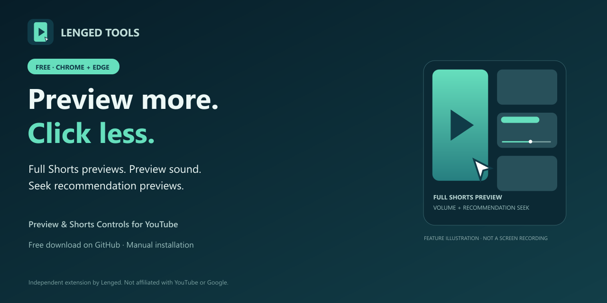

# Preview & Shorts Controls for YouTube

Free browser extension by **Lenged**. Preview videos in place, control their sound and playback position, and keep Shorts information out of the way.

[Download v0.5.2](https://github.com/orockandgto-glitch/shorts-in-place-preview/raw/main/Preview-Shorts-Controls-0.5.2.zip) · [Release history](https://github.com/orockandgto-glitch/shorts-in-place-preview/releases) · [Report a bug](https://github.com/orockandgto-glitch/shorts-in-place-preview/issues) · [Buy Lenged a coffee](https://buymeacoffee.com/lenged)

**Preview more. Click less.** Hover over a home Shorts thumbnail to keep watching in place. Turn preview sound on when you want it. On a watch page, jump to a different moment in a related-video preview, then return to your main video with its audio restored.

All features are free. No account for this extension and no paid feature unlocks. Current distribution is a GitHub ZIP with manual installation; Chrome Web Store availability has not been announced.

[How to use it / 사용 안내](USER-GUIDE.md) · [Official updates on X](https://x.com/LengedTools)

## Features

- Full home Shorts and watch-page recommendation previews inside existing thumbnails. No separate playback window or floating player.
- Top-left mute and volume controls for home video, home Shorts and recommendation previews. Each new card starts muted.
- Enabling recommendation preview sound temporarily mutes the main video. Leaving or muting the preview restores the main video's previous mute and volume state; the main video keeps playing.
- A bottom seek slider with current and total time on recommendation previews. Seeking preserves the selected audio state during buffering. Unknown or infinite durations cannot be scrubbed.
- Optional title/channel auto-hide on Shorts viewing pages: hover over the video to reveal information, move away to hide it. Keyboard focus on metadata also reveals it. No extra Info button.
- Individual feature switches, hover delay and saved volume. Native home-preview visibility repair is applied automatically.

## Compatibility

| Browser | Status |
| --- | --- |
| Microsoft Edge desktop | v0.5.2 tested in actual use |
| Google Chrome desktop | v0.5.2 manually tested by the author on 2026-10-15; all features reported working |
| Whale desktop | Chromium compatibility is expected, but not yet tested |
| Firefox / Safari | Not supported by this package; porting and testing are required |

The extension depends on YouTube's internal player and page structure, which can change without notice. Ads have been observed during previews, but ads, live and restricted content are not comprehensively tested. Preview playback may affect YouTube watch history or recommendations. This is not an ad blocker.

The Edge store update is being prepared; a public store listing has not been verified. GitHub download availability does not imply store approval.

## Install manually on Edge or Chrome

1. Download the **v0.5.2 ZIP** above and extract it into a permanent folder. Select the folder that directly contains `manifest.json` when loading.
2. Open `edge://extensions` (Edge) or `chrome://extensions` (Chrome) and enable **Developer mode**.
3. Choose **Load unpacked** and select that extracted folder.
4. Disable older separate copies of Shorts In-place Preview, Preview Volume Control and Shorts Clear View to avoid duplicate controls.
5. Refresh YouTube. Open this extension's toolbar icon for options, instructions and support.

For a source checkout, select the repository's **extension** folder instead of the repository root. The automatically generated GitHub “Source code” ZIP and the installable extension ZIP have different folder layouts.

Manual installations do not automatically update from GitHub. Download a newer extension ZIP into the same installation folder, reload the extension and refresh YouTube. Keep backups when testing a new version. Store-managed updates will use their store's update flow when available.

## Support and funding

**Every feature is free. Donations are optional.** Use the repository's Sponsor button or [Buy Me a Coffee](https://buymeacoffee.com/lenged) to support development. The extension's Help & Settings page also links to the same page. Donations do not unlock features or guarantee future updates. Checkout takes place on the external service; its terms and privacy policy apply.

No automatic donation tabs, payment popups or in-video funding overlays are added. [SUPPORT.md](SUPPORT.md) explains bug reports and support routes.

## Privacy and source

No developer backend, analytics or viewing-history upload is included. Preferences stay in `chrome.storage.local`; YouTube still handles playback requests and its own data processing. See [PRIVACY.md](PRIVACY.md).

Source is published in `extension/` for inspection. No open-source reuse license has been selected yet; contact the author before reusing or redistributing the code. See [CHANGELOG.md](CHANGELOG.md) for updates.

Independent project; not affiliated with YouTube, Google, Microsoft, Naver or Apple.

---

## 한국어

**클릭하기 전에, 제대로 미리보기.** [한국어 소개 이미지](media/launch-ko-1280x640.png)

**Lenged가 만드는 무료 확장프로그램입니다.** 홈 Shorts와 우측 추천 영상을 썸네일 안에서 계속 보고, 미리보기 소리·음량·재생 위치를 조절할 수 있습니다. Shorts 시청 화면의 제목·채널 정보 자동 숨김도 제공합니다. 모든 기능은 후원 여부와 관계없이 무료입니다.

### 설치

1. 위의 **Download v0.5.2**에서 ZIP을 받아 고정된 폴더에 압축을 풉니다.
2. Edge에서 `edge://extensions` → **개발자 모드** → **압축 해제된 확장 로드**를 선택합니다.
3. `manifest.json`이 바로 들어 있는 폴더를 선택하고 YouTube를 새로고침합니다.
4. 기존 개별 재생·볼륨·정보 숨김 확장은 잠시 꺼서 중복 실행을 막습니다.
5. 확장 아이콘을 누르면 옵션·설명·후원 안내를 볼 수 있습니다.

소스를 통째로 받았다면 저장소 최상위가 아닌 **extension 폴더**를 선택하세요. GitHub 수동 설치는 자동 업데이트되지 않습니다. 새 ZIP을 설치 폴더에 반영한 뒤 확장과 YouTube를 새로고침하세요.

현재 **Edge 실제 사용 확인 완료**, **Chrome은 2026-10-15 개발자 직접 사용 테스트에서 전체 기능 정상 동작을 확인**했습니다. Chrome 페이지에서도 0.5.2 실행·준비 완료 상태와 Shorts 카드 10개 인식을 확인했습니다. 웨일은 호환 예상 단계이며 실제 테스트 전입니다. Firefox·Safari는 별도 이식이 필요합니다. YouTube 변경으로 작동이 중단될 수 있고 모든 광고·라이브·제한 콘텐츠를 검증한 것은 아닙니다.

Chrome에서는 `chrome://extensions`에서 개발자 모드를 켜고 같은 **extension 폴더**를 압축 해제된 확장으로 로드하면 됩니다. Chrome 웹 스토어 등록은 별도이며 현재 GitHub 수동 설치를 제공합니다.

[버그 신고](https://github.com/orockandgto-glitch/shorts-in-place-preview/issues) · [개인정보처리방침](PRIVACY.md) · [선택적 개발 후원](https://buymeacoffee.com/lenged)

소스는 확인할 수 있도록 공개했으며 재사용·재배포를 위한 오픈소스 라이선스는 아직 정하지 않았습니다. 후원은 추가 기능 구매나 지속적 업데이트 보장이 아닙니다.
